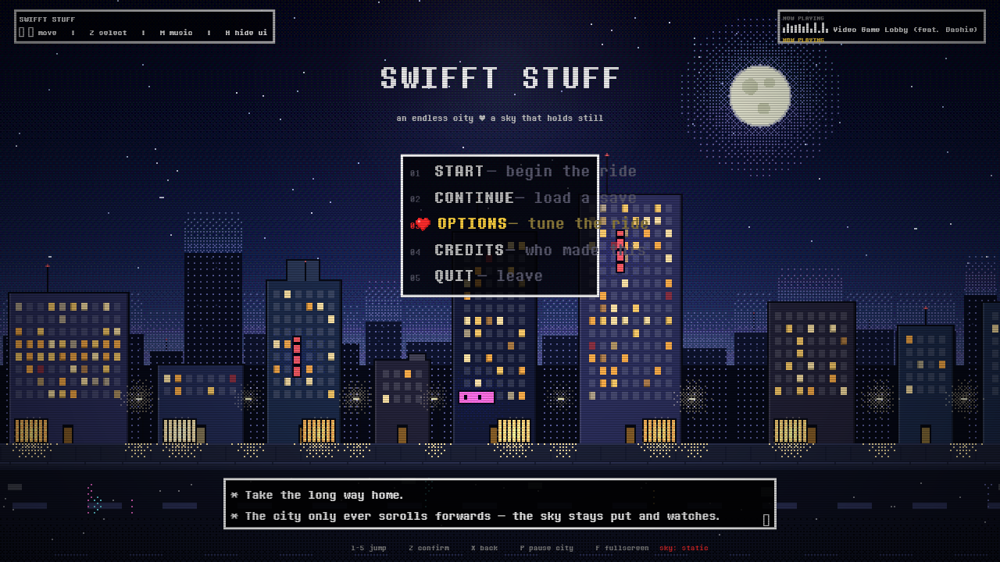

# SWIFFT STUFF — a city that never stops moving, under a sky that never starts

An Undertale-flavoured **main menu** for Swifft Stuff: a procedurally generated,
endlessly scrolling pixel-art night city with a soul cursor, dialogue-box panels
and synth UI blips. Open `index.html` and press a key.



*(that's a render straight out of `tools/mock-render.cjs` — same city engine,
same font, same sizes as the live page)*

```
open index.html            # or run any static server, e.g.
python3 -m http.server 8000
```

## Controls

| key | what it does |
| --- | --- |
| `↑` `↓` / `W` `S` | move the soul (hold-friendly, wraps around) |
| `Z` / `Enter` / `Space` | confirm |
| `X` / `Esc` | back |
| `←` `→` | adjust the highlighted option (in OPTIONS) |
| `1` … `5` | jump straight to a menu entry |
| `M` | music on / off |
| `P` | pause the city (it holds its breath) |
| `H` | hide the whole UI and just watch the city |
| `F` | fullscreen |

Clicking works everywhere too: click an entry to select, click again to confirm.

## The music

The lobby theme is **“Video Game Lobby (feat. Dashie)”**. Drop the mp3 at:

```
assets/audio/Video Game Lobby (feat. Dashie).mp3
```

…or just **drag the mp3 onto the window** — it becomes the theme immediately
(played from a local blob URL, nothing is uploaded). If the file isn't there
yet, the menu keeps working; the box in the top right tells you what it wants.

## What's in the box

```
index.html                 the menu
assets/css/menu.css        Undertale box UI, pixel type, CRT overlay
assets/js/art.js           procedural pixel art (skies, buildings, heart, glow)
assets/js/city.js          the parallax city + animation layer
assets/js/audio.js         UI blips (WebAudio) + the lobby soundtrack
assets/js/menu.js          menu logic, options, keyboard, drag & drop
assets/fonts/              Determination Mono (the Undertale dialogue font, web build)
assets/audio/              ← the mp3 goes here
tools/render-preview.cjs   headless scene renderer (PNG out)
tools/mock-render.cjs      headless mock-up of the full menu screen
tools/smoke-test.cjs       jsdom test: 36 checks over the real index.html
```

## How the city works

Four layers, four different speeds, one rule:

| layer | parallax | notes |
| --- | --- | --- |
| sky | **0.00** | stars, moon, dithered haze — **it does not move** |
| far | 0.08 | distant skyline, tiny lit windows, beacons |
| mid | 0.55 | the buildings you drift past: rooftops, water towers, neon, lamps |
| street | 1.00 | asphalt, dashes, wet reflections, manholes |

Tiles are baked once at 1× game resolution into offscreen canvases (seeded, so
the scene is reproducible) and blitted with `imageSmoothingEnabled = false`, so
everything stays properly pixel-crisp at any window size. Anything that moves
faster than the bake — blinking beacons, windows flicking on and off, lamp
halos — is drawn per frame on top of the baked tile.

The composition is anchored to the bottom of the window: the baked 640×480
scene is pushed down until the skyline sits at ~65% of the screen height, and
the sky is generated to fill everything above it. The UI unit `--u` is an
integer derived from the window size, so the pixel font never lands on half a
pixel.

## Dev tools

```bash
NODE_PATH=/path/to/node_modules node tools/render-preview.cjs /tmp/out   # scene PNGs
NODE_PATH=/path/to/node_modules node tools/mock-render.cjs /tmp/menu.png 1280 720
NODE_PATH=/path/to/node_modules node tools/smoke-test.cjs                # 36 checks
```

`tools/mock-render.cjs` uses `@napi-rs/canvas`, so install it somewhere out of
tree (`npm i @napi-rs/canvas`) and point `NODE_PATH` at it. The smoke test runs
the real `index.html` through jsdom with a stubbed canvas/audio layer and
asserts that the menu builds, the soul moves, the options actually change the
city, the sky's parallax stays at zero, and dropping an mp3 switches the theme.

## Credits

- Font: **Determination Mono** (the Undertale dialogue font, web build)
- Music: “Video Game Lobby (feat. Dashie)”
- Everything else: generated from the pixels up.
